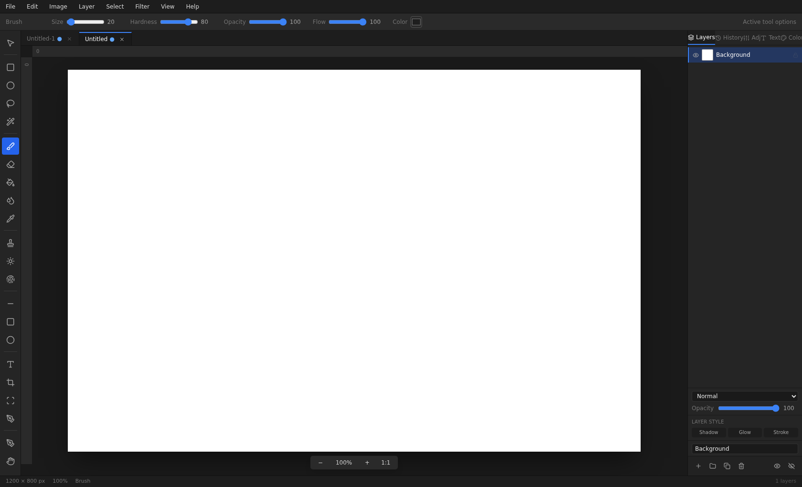

<div align="center">


# Photon Studio

**A professional, layer-based image editor built with React, TypeScript, and Canvas — inspired by Photoshop's workflow, with an original interface.**

Runs entirely in the browser today, with an architecture ready for Tauri 2 desktop packaging.

[](https://github.com/e2sy/photon-studio/actions/workflows/ci.yml)
[](LICENSE)
[](tsconfig.app.json)
[](https://react.dev)
[](https://tauri.app)
[](CONTRIBUTING.md)

</div>

---



<p align="center"><em>Photon Studio — full editing session with multi-document tabs, layers panel, blend modes, and layer styles.</em></p>

## ✨ Features

### Documents & layers
- **Multi-document tabs** — open many images at once, with unsaved-change indicators and close prompts
- **Full layer system** — raster, text, group, and adjustment layers with add / delete / duplicate / drag-reorder / rename / lock / visibility / opacity
- **Nested groups** — drop a layer onto a group to nest it; collapse, expand, and indent like a pro
- **Non-destructive layer styles** — drop shadow, outer glow, and stroke with per-effect color / size / offset / opacity, rendered live in the compositor
- **Layer masks** — white reveals, black hides; paint directly on masks with any soft-edge brush, apply when done

### Painting & retouching
- **Brush engine** — size / hardness / opacity / flow / spacing with pen-pressure support, plus eraser and paint bucket (tolerance-based flood fill)
- **Gradient tool** — linear and radial, selection-aware
- **Retouching** — clone stamp, dodge/burn, smudge, and a full curves dialog
- **Shape tools** — line, rectangle, ellipse with fill or outline
- **Text layers** — font family, size, weight, alignment, line height, and color that survive save/reload as editable text

### Selections & transforms
- **Selection tools** — rectangle, ellipse, lasso, and magic wand with tolerance, feathering, select all / deselect
- **Free transform** — scale, rotate (15° snapping), flip H/V
- **Perspective transform** — drag four corner handles and the layer warps via inverse bilinear sampling

### Color & filters
- **Adjustments** — brightness/contrast, hue/saturation/lightness, levels, invert, grayscale — as one-shot edits *or* non-destructive adjustment layers
- **Filters** — Gaussian blur, box blur, sharpen, pixelate, noise, edge detect, sepia, and more, all offloaded to a **Web Worker** so the UI never blocks
- **Filter Gallery** — browse every filter in one window with a unified strength control
- **Blend modes** — Normal, Multiply, Screen, Overlay, Darken, Lighten, Difference — real pixel math, verified by tests

### Workflow
- **History** — full undo/redo with a history panel; one entry per stroke; click any entry to time-travel
- **Import** — file picker, drag-and-drop, or clipboard paste (PNG / JPEG / WebP / BMP)
- **Export** — PNG, JPEG, or WebP of the full composite
- **`.photon` native format** — a versioned project file preserving all layers, masks, text, and pixel data; rejects corrupt files
- **Autosave** — crash recovery built in
- **Shortcuts** — a full Photoshop-style keyboard map (see below)

## 🚀 Quick start

```bash
git clone https://github.com/e2sy/photon-studio.git
cd photon-studio
npm install
npm run dev
```

Open **http://localhost:5173** and start editing.

### Available scripts

| Command | What it does |
|---|---|
| `npm run dev` | Vite dev server with hot reload |
| `npm run build` | Production build to `dist/` |
| `npm run preview` | Serve the production build locally |
| `npm run typecheck` | Strict TypeScript check |
| `npm run lint` | ESLint |
| `npm test` | Headless engine test suite (39 checks) |
| `npm run tauri:dev` | Run the Tauri 2 desktop shell in dev mode |
| `npm run tauri:build` | Package desktop installers |

## 🖥️ Desktop packaging (Tauri 2)

The app is structured for a thin Tauri shell. On a machine with [Rust](https://rustup.rs) and the platform WebView installed:

```bash
npm install -D @tauri-apps/cli   # already a devDependency here
npx tauri init                   # frontend dist: dist, dev server: http://localhost:5173
npx tauri dev
npx tauri build                  # Windows .msi/.exe, macOS .app/.dmg, Linux .deb/.AppImage
```

Native file dialogs and filesystem access go through `src/desktop/nativeBridge.ts`, which detects the Tauri context and falls back to browser APIs on the web — the editor engine itself needs no changes.

## 🏗️ Architecture

```
src/editor/       Engine (no UI): types, document model, blend, painting,
                  imaging, renderer, history, serializer, store, shortcuts
src/components/   React UI: menu bar, options bar, toolbar, canvas, panels
src/workers/      Web Worker filter pipeline
src/desktop/      Tauri native bridge with browser fallback
scripts/          Headless engine test suite
src-tauri/        Tauri 2 shell (Rust)
```

The defining constraint of this codebase: **the engine is fully separated from React and the DOM**. Everything in `src/editor/` is pure TypeScript that runs headlessly in Node — which is exactly how the test suite works — and the same engine can be hosted inside a Tauri app, an Electron app, or a Web Worker without modification.

```
┌────────────────────────────────────────────────────────┐
│  React UI (src/components)                             │
│  MenuBar · Toolbar · OptionsBar · CanvasWorkspace      │
│  RightPanels · DocumentTabs · Dialogs                  │
├────────────────────────────────────────────────────────┤
│  Zustand store (src/editor/store.ts)                   │
│  single source of truth for documents, layers, tools   │
├───────────────────────────────┬────────────────────────┤
│  Engine (src/editor)          │  Filter Worker         │
│  document · blend · painting  │  (src/workers)         │
│  imaging · renderer · history │  heavy pixel ops run   │
│  serializer · retouch         │  off the main thread   │
├───────────────────────────────┴────────────────────────┤
│  Canvas 2D compositor  →  .photon serializer  →  disk  │
└────────────────────────────────────────────────────────┘
```

## ⌨️ Keyboard shortcuts

| Keys | Action |
|---|---|
| `V` `M` `L` `W` `B` `E` `G` `I` `T` `C` `Z` `H` | Move · Marquee · Lasso · Wand · Brush · Eraser · Gradient · Eyedropper · Text · Clone · Zoom · Hand |
| `Ctrl+Z` / `Ctrl+Shift+Z` or `Ctrl+Y` | Undo / Redo |
| `Ctrl+A` / `Ctrl+D` | Select all / Deselect |
| `Ctrl+J` | Duplicate layer |
| `Delete` / `Backspace` | Clear selection |
| `Space` + drag | Pan canvas |
| `Ctrl` + wheel | Zoom |

## 🧪 Testing

The engine test suite runs headlessly in Node — no browser, no DOM — proving the engine's UI independence:

```bash
npm test
```

It covers blend-mode pixel math, layer operations, history undo/redo (including delete-restore), serialization round-trips, and more. New engine features should always ship with new checks — see [CONTRIBUTING.md](CONTRIBUTING.md).

## 🗺️ Roadmap

**Engine**
- [ ] Extended blend modes: Soft Light, Hard Light, Color Dodge/Burn, Hue, Saturation, Color, Luminosity
- [ ] Tile-based undo history for lower memory usage on large documents
- [ ] GPU-accelerated compositor (WebGL2 / WebGPU) as an opt-in renderer
- [ ] PSD import (read-only) alongside the native `.photon` format

**UX**
- [ ] Rulers, guides, grid, and smart snapping
- [ ] Touch and trackpad gesture support
- [ ] Export individual layers and selected layers
- [ ] Customizable keyboard shortcuts

**Desktop**
- [ ] Fix `nativeBridge.ts` to use the Tauri v2 `plugin-fs` API end-to-end (currently mixes v1 `window.__TAURI__` calls)
- [ ] Signed installers + auto-update channel

**Platform**
- [ ] PWA support — installable and fully offline in the browser
- [ ] Plugin API for community filters and tools
- [ ] Optional cloud sync of `.photon` projects

## 🤝 Contributing

Contributions are welcome! The engine's purity rule, verification checklist, and PR process are all documented in [CONTRIBUTING.md](CONTRIBUTING.md). If you're looking for something to work on, the [roadmap](#️-roadmap) is a good place to start.

## 📄 License

[MIT](LICENSE) © 2026 Mayank Bhaskar
